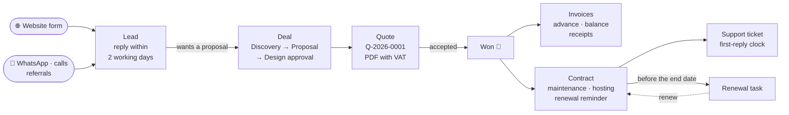
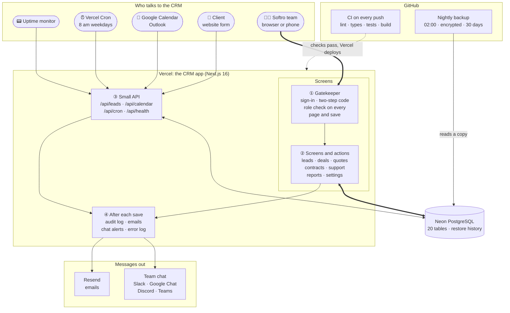

# Softro CRM: System Overview

A plain-words tour of the whole project: what it is, who uses it, and how a client goes from a website enquiry to a signed contract, support tickets and a renewal, all in one place.

---

## What it is

**Softro CRM** is Softro Code Labs' own customer relationship system. It keeps every enquiry, deal, quote, invoice, contract and support request in one place, so nothing lives only in someone's WhatsApp or memory.

It was built for how we actually work: clients reach us by **WhatsApp, the website, referrals and calls**, we promise a **reply within 2 working days**, we sell **websites, apps and business systems** by quote, and we keep clients on **maintenance and support contracts** afterwards.

- 🎯 **Nothing slips:** every lead has a reply-by deadline, every ticket a first-reply time, every contract a renewal reminder.
- 🧾 **Quotes in minutes:** a services price list, discounts, VAT, and a branded PDF with our bank details and an *Accepted by* signature block.
- 💰 **Invoices and receipts:** invoice an accepted quote in one click (advance %, full or balance), record payments, send numbered receipts, and see who owes us what. Prints as a **Tax Invoice** once we're VAT registered.
- 📊 **Clear numbers:** won revenue, win rate, a weighted forecast and team performance, in LKR, with nothing added across currencies.
- 🔔 **Tells you what to do:** an 8 am summary email, alerts when something is assigned to you, and your tasks in Google Calendar.
- 🔒 **Safe by default:** roles, two-step sign-in, an audit log of every change, and nightly encrypted backups.
- 📱 **Works on phones**, and every time is shown in Sri Lanka time.

## Who uses it

| Who | What they do |
|---|---|
| **Admin** | Everything, plus team members, security rules, integrations, system health and the audit log |
| **Manager** | Runs sales and support: sees everything, edits the pipeline and price list, exports reports, deletes records |
| **Sales** | Works leads and deals, sends quotes, sets up contracts |
| **Support** | Handles support tickets, adds leads and contacts |
| **Viewer** | Read-only: sees everything, changes nothing |
| **Clients** (indirectly) | Send enquiries through the website form, which arrive as leads |

The rules for every role live in one file, `src/lib/permissions.ts`, and are checked again on every page and every save.

---

## The parts of the CRM

| Part | What it does | The key rule |
|---|---|---|
| **Leads** | New enquiries from WhatsApp, the website, referrals, calls, Upwork/Fiverr… | Reply within **2 working days** (Mon–Fri, Sri Lanka time). Overdue ones turn red. |
| **Deals** | Real opportunities on a drag-and-drop board: Discovery call → Proposal & quote → Design approval → Won / Lost | Every stage has a win %, which feeds the forecast. Lost deals need a reason. |
| **Quotes** | Line items from the price list, discounts, VAT, a branded PDF with an *Accepted by* block for the client | Numbered **Q-2026-0001**. Accepted quotes are locked; changes make a new version. |
| **Invoices** | From an accepted quote (advance %, full or balance), a contract period, or by hand. Payments with numbered receipts | **INV-2026-0001** and **RCT-2026-0001**. Advance + balance always add up to the quote. Never deleted: void instead. A *Follow up payment* task is due the day after the due date. |
| **Companies & contacts** | Every client and the people we talk to, with a WhatsApp button | Winning a deal turns a prospect into a customer. |
| **Activities** | Calls, WhatsApp chats, emails, meetings, tasks and notes on every record | Tasks have owners and due dates, and show on the dashboard and in calendars. |
| **Contracts** | Maintenance, hosting, support retainers and subscriptions | Numbered **C-…**. A renewal task appears before the end date; one click renews. |
| **Support** | Client problems as tickets, with replies and internal notes | Numbered **T-…**. First reply due by priority (4 h urgent → 72 h low) or the contract's promise. |
| **Project access** | Each project's Google account, the services made with it, who owns them, renewals, and a handover PDF for the client | **No secrets stored**: passwords stay in the password manager. A 6-monthly sign-in check keeps each project Gmail alive. |
| **Reports** | Revenue, win rate, forecast, lead sources, team and support performance | Pick any period or person, and export to CSV. |
| **Settings** | Team, pipeline, company details, price list, integrations, security, system health, audit log | Most are admin-only. |

---

## A client's story

1. **Enquiry.** Nimal fills in "Start your project" on softrocodelabs.com. Seconds later it's a **lead** in the CRM, assigned to Dilini, who gets an email and a ping in the team chat. A **reply-by** time is set for 2 working days later.
2. **First reply.** Dilini taps the WhatsApp button, chats with Nimal and logs it. The lead turns from *New* to *Contacted*, and the reply clock stops.
3. **Deal.** Nimal wants a proposal. **Convert to deal** creates the deal, his company and his contact in one step.
4. **Quote.** Dilini builds a quote from the price list (design, development, hosting), adds 18% VAT and sends the PDF. Nimal signs the *Accepted by* block and sends it back; she marks the quote **accepted** and the deal's value updates.
5. **Won and invoiced.** She marks the deal **Won** 🎉 and, from the quote, creates a **50% advance invoice**. When Nimal's bank transfer arrives she records it and sends the **receipt**. At launch she invoices the **balance**.
6. **After launch.** She adds a yearly **maintenance contract** with a promised 8-hour first reply. A month before it ends, a **renewal task** appears on her dashboard.
7. **Support.** Nimal reports a checkout error on WhatsApp. Ruwan logs a **ticket** under the contract. The 8-hour clock starts, and his reply is logged against it.
8. **Every morning** at 8 am, each person gets one email of what's due today, overdue items first.

---

## How it fits together

One Next.js app on **Vercel** does everything: the screens, the saving and the small API. All data lives in one **PostgreSQL** database on **Neon**. A few outside services send emails and messages, and GitHub checks the code and keeps backups.

| Layer | What it does |
|---|---|
| **① Gatekeeper** | Signed-out visitors are sent to sign in. After the password, people with two-step sign-in enter a code. Then **every** page and every save re-checks who you are and what your role allows, so a deactivated person is locked out at once. |
| **② Screens and actions** | Each area (`src/app/(app)/<area>/`) has its pages and an `actions.ts` that saves changes. Every form is checked by a Zod schema on the server, whatever the browser sends. |
| **③ Small API** | Only four doors accept outside calls: the website form (needs an API key), each person's private calendar link, the 8 am job (needs a secret) and the health check. |
| **④ After each save** | Every change is written to the audit log. Emails and chat messages go out *after* the page responds, so nobody waits, and a failed email never breaks a save. Server errors are logged and alert the admins. |
| **Database** | One Neon PostgreSQL database with 20 tables. Neon keeps a restore history, and GitHub keeps 30 nightly encrypted copies. |

### What runs by itself

| When | What happens |
|---|---|
| **Every save** | Audit log entry. If someone else was given a lead, task or ticket, they get an email. |
| **A website enquiry arrives** | New lead with a reply-by time. The owner gets an email (reply goes straight to the client), and the team chat gets a message. |
| **A deal is won · an urgent ticket opens** | Team chat message |
| **A contract is saved** | Its renewal task is created or moved to match the dates |
| **8:00 am, weekdays** | Morning summary emails. Old rate-limit counters and fixed errors are cleaned up. |
| **About every hour** | Calendar apps fetch each person's tasks |
| **02:00 every night** | GitHub makes an encrypted copy of the database |
| **Every push to GitHub** | CI runs all checks. Production deploys apply database changes, then go live. |
| **Any server error** | Recorded on Settings → System health. Admins get one alert per error per hour. |

---

## Why the team can trust it

- **Only the right people get in.** Passwords are hashed (bcrypt). Two-step sign-in with an authenticator app can be required for admins and managers. 5 wrong passwords lock an account for 15 minutes, and too many attempts from one network are paused.
- **Each person sees and does only what their role allows**, checked on the server on every request, not just by hiding buttons.
- **Every change has a name on it.** Sign-ins, edits, deletions and exports are in the audit log.
- **Secrets stay secret.** Two-step setups are encrypted in the database, recovery codes are stored scrambled, calendar links are stored only as fingerprints, and webhook addresses are never shown in full again.
- **Safe with outside input.** Emails escape anything a client typed, CSV exports can't run spreadsheet formulas, and team-chat links are limited to Slack, Google Chat, Discord and Teams.
- **Locked-down pages.** A strict Content-Security-Policy, HTTPS-only (HSTS) and no framing by other sites.
- **Nothing lost.** Neon's restore history, plus 30 nightly encrypted backups. Restoring was tested: every row came back.

## Why the numbers hold up

- **Money is worked in whole cents**, so quote totals never drift by a cent: line discount → quote discount → VAT.
- **Currencies are never mixed.** LKR and USD totals are shown separately, everywhere.
- **Time is Sri Lanka time.** Reply deadlines skip weekends, and months in reports start at midnight in Colombo, not in London.
- **Numbers never clash.** Q-, C- and T- numbers come from a counter updated inside a database transaction.
- **46 automated tests**: 33 unit tests (two-step codes against the official RFC 6238 examples, VAT maths, working days, permissions, CSV safety…) and 13 browser tests that sign in and click through real journeys.
- **Every change is checked before it reaches `main`**: lint, type-check, tests, a dependency audit, a full build and the browser tests.

---

## Look and feel

One idea runs through the design: **calm, dark-and-crimson, like softrocodelabs.com.** Every list, detail page and form has the same layout, so once you've learnt one area you know them all.

**Dark mode is the default.** Anyone can switch to light, or follow their device, from the moon icon at the top right; the choice is remembered per browser. The sidebar and sign-in screens are dark in both themes, and quote previews stay white like the printed PDF.

| Colour | Dark theme (default) | Light theme |
|---|---|---|
| Page background | Near-black `#111013` | Warm paper `#f8f6f2` |
| Cards | Charcoal `#1c1b1f` | White |
| Text | Warm off-white `#f3efe8` | Ink `#161517` |
| Sidebar and sign-in | Ink `#0b0b0d` | Ink `#0b0b0d` |
| Brand: active menu item, highlights, charts | Softro crimson `#c2283a` / `#a70b21` | Softro crimson |
| Status: on track · due soon · overdue | Green · amber · red, as soft dark washes | Green · amber · red, as soft tints |

Status colours always come with a word or icon, never colour alone.

**Font:** Geist Sans for everything, Geist Mono for numbers like Q-2026-0001. Both are self-hosted.

**Logo:** the Softro Code Labs mark (the same artwork as the website, never redrawn) with **Softro** in a heavier weight and **CRM** lighter, matching the "Softro Code Labs" lockup.

**Every area follows the same pattern:** list with tabs, search and filters → detail page with the record on the left and its timeline, quotes or tickets beside it → one form for adding and editing.

---

## Built with

Next.js 16 · React 19 · TypeScript · PostgreSQL (Neon) · Prisma 7 · Tailwind CSS v4 · Zod · jose · bcrypt · React-PDF · qrcode · Resend · Vitest · Playwright · GitHub Actions · Vercel (hosting and cron)

## Where to find things

| Part | Folder |
|---|---|
| The data model (27 tables) and migrations | `prisma/schema.prisma`, `prisma/migrations/` |
| Screens and the actions that save them | `src/app/(app)/<area>/` |
| Sign-in and two-step sign-in pages | `src/app/login/`, `src/app/setup-two-factor/` |
| The small API | `src/app/api/` (`leads`, `calendar`, `cron`, `health`) |
| Who can do what | `src/lib/permissions.ts` |
| Sign-in checks, sessions, 2FA, rate limits | `src/lib/auth.ts`, `src/lib/session.ts`, `src/lib/security/` |
| Business rules (working days, quote maths, invoices, SLA, reports) | `src/lib/working-days.ts`, `quote-math.ts`, `invoices.ts`, `amount-in-words.ts`, `tickets.ts`, `reports.ts` |
| PDFs (quote, invoice, receipt, handover) | `src/lib/pdf/` |
| Emails, chat, morning summary, calendar | `src/lib/integrations/` |
| Error log and start-up checks | `src/lib/monitoring/`, `src/instrumentation.ts`, `src/lib/env.ts` |
| Shared look (buttons, fields, cards) | `src/components/ui/`, colours in `src/app/globals.css` |
| Tests | `tests/unit/`, `tests/e2e/` |
| CI and backups | `.github/workflows/` |
| Guide for the team | `docs/USER-GUIDE.md` |

Setup, settings and deploying are in the **[README](README.md)**. How to use each screen is in the **[user guide](docs/USER-GUIDE.md)**.

---

## How it was built

Nine steps, each one usable on its own before the next began.

| Step | What it added |
|---|---|
| **1. Foundation** | Sign-in, roles, the app layout, companies, contacts, the audit log |
| **2. Sales pipeline** | Leads with the 2-working-day reply promise, the deals board, the website form → CRM link |
| **3. Activities** | Calls, WhatsApp chats, meetings, tasks and notes on every record; "My tasks" on the dashboard |
| **4. Team & settings** | Adding staff with temporary passwords, account lock, pipeline editor, audit log viewer |
| **5. Quotes** | Price list, quotes with discounts and VAT, branded PDFs, company and bank details |
| **6. Contracts & support** | Contracts with renewal reminders, support tickets with first-reply times |
| **7. Reports** | Revenue, win rate, forecast, lead sources, team and support performance, CSV exports |
| **8. Integrations** | Emails through Resend, the morning summary, team chat alerts, calendar links, accounting export |
| **9. Hardening** | Two-step sign-in, rate limits, error monitoring, health check, tests, CI, auto-migrations, nightly backups |

Added since: dark mode, profile photos, the project access register with a handover PDF, and **invoices and receipts** (advance and balance invoices from accepted quotes, contract invoices, payments with receipts, a Tax Invoice layout, and an *Accepted by* block on quotes).

---

## Good to know

- **The CRM is only as good as what goes in.** Log every reply, keep close dates and values current, and mark deals won or lost with a reason. Reports and the forecast depend on it.
- **One Google account per project.** Everything for a project is signed up with its own Gmail, so finished projects need no browser profile. The CRM records where everything is; the secrets themselves live only in the password manager.
- **Every check happens on the server.** Hiding a button is for convenience only; the rule in `permissions.ts` is what actually protects the data.
- **Previews never touch live data.** Preview deploys use a separate database branch, send no emails and skip migrations unless told otherwise.
- **Set `ENCRYPTION_KEY` once and never change it**, or everyone has to set up two-step sign-in again.
- **Public and poya holidays aren't counted yet** in reply deadlines. Only weekends are skipped.
- **Ideas for later:** two-way Gmail/Outlook sync and WhatsApp Business messages from inside the CRM. Both need approval from Google, Microsoft or Meta first.
- **Built by Softro Code Labs**, November 2026.
